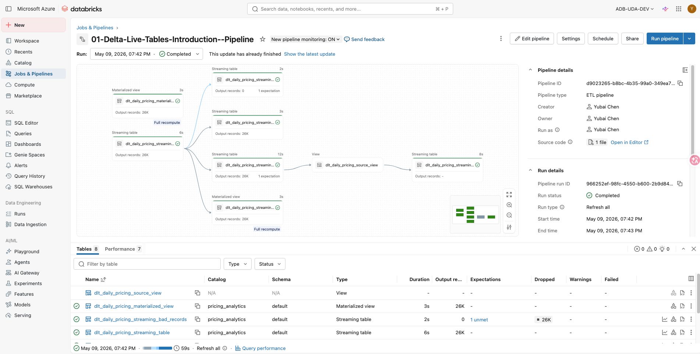
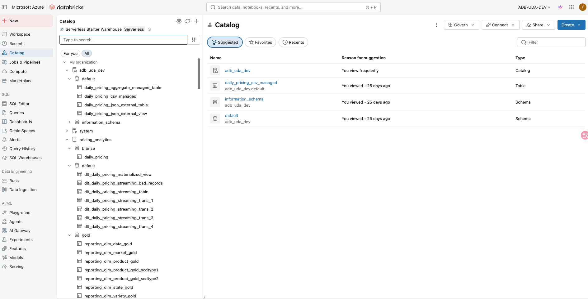
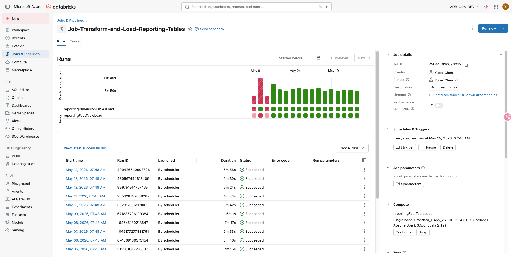

# DataAnalytics

End-to-end Azure Databricks Data Engineering project using PySpark, Spark SQL, Delta Lake, Delta Live Tables, Structured Streaming, Unity Catalog, and Azure Data Lake Storage Gen2.

This repository demonstrates a cloud-based Lakehouse data engineering workflow following the Medallion Architecture pattern: Bronze, Silver, and Gold layers.

---

## Project Overview

This project simulates a real-world data engineering solution for ingesting, transforming, storing, and serving analytical data using Azure Databricks.

The project covers:

- Batch data ingestion
- API and JSON data processing
- Database source ingestion
- PySpark transformations
- Spark SQL analytics
- Delta Lake table management
- Delta Live Tables pipelines
- Structured Streaming pipelines
- Performance tuning
- Unity Catalog and Azure resource setup
- GitHub-based version control and CI/CD preparation

---

## Architecture

### Lakehouse / Medallion Architecture

```text
Source Systems
    |
    |-- APIs
    |-- JSON Files
    |-- SQL Database Tables
    |-- Streaming Sources
    |
    v
Bronze Layer
Raw data ingestion
    |
    v
Silver Layer
Cleaned, validated, and transformed data
    |
    v
Gold Layer
Business-ready reporting tables
    |
    v
Analytics / BI / Reporting
```

The solution separates raw, cleaned, and business-ready data into different layers to improve scalability, maintainability, and analytical usability.

---

## Project Screenshots

### Delta Live Tables Pipeline



### Unity Catalog and Databricks Environment



### Databricks Job Workflow



More screenshots are available in the [`screenshots`](screenshots/) folder.

---

## Technologies Used

| Category | Technologies |
|---|---|
| Cloud Platform | Microsoft Azure |
| Data Platform | Azure Databricks |
| Data Processing | PySpark, Spark SQL |
| Lakehouse Storage | Delta Lake |
| Streaming | Spark Structured Streaming |
| ETL Framework | Delta Live Tables |
| Data Governance | Unity Catalog |
| Cloud Storage | Azure Data Lake Storage Gen2 |
| Version Control | Git, GitHub |
| CI/CD Preparation | GitHub Actions |
| Development Environment | Databricks Notebooks |

---

## Repository Structure

```text
DataAnalytics/
│
├── 01-Ingestion/
│   └── Data ingestion notebooks and source loading logic
│
├── 02-Transform/
│   └── Data transformation and loading logic
│
├── Delta-Live-Table/
│   └── Delta Live Tables pipeline implementation
│
├── Performance-Tuning/
│   └── Spark and Delta performance optimization examples
│
├── Pyspark-Introduction/
│   └── PySpark fundamentals and DataFrame operations
│
├── Spark-Structured-Streaming-Introduction/
│   └── Structured Streaming examples and checkpointing logic
│
├── SparkSQL-Introduction/
│   └── Spark SQL examples and analytical queries
│
├── sql/
│   └── SQL scripts for table creation and data processing
│
├── screenshots/
│   └── Project screenshots, pipeline images, job workflows, and Azure setup evidence
│
├── .github/
│   └── GitHub workflow / CI-CD related configuration
│
└── README.md
```

---

## Main Components

### 1. Data Ingestion

The ingestion layer includes examples of loading data from multiple source types, including APIs, JSON files, and database tables.

Key concepts:

- Reading data from external sources
- Writing raw data into the Bronze layer
- Managing source-to-target ingestion workflows
- Handling structured and semi-structured data

---

### 2. Data Transformation

The transformation layer focuses on cleaning, reshaping, and enriching raw data for analytical use.

Key concepts:

- PySpark DataFrame transformations
- Spark SQL queries
- Joins and aggregations
- Data type handling
- Business-ready table preparation

---

### 3. Delta Lake

Delta Lake is used as the core storage layer for reliable Lakehouse data management.

Key concepts:

- Delta table creation
- ACID transactions
- MERGE operations
- Upserts
- Time travel
- Partitioning and optimization

---

### 4. Delta Live Tables

Delta Live Tables is used to build declarative ETL pipelines in Databricks.

Key concepts:

- DLT tables and views
- Streaming tables
- Data quality expectations
- Pipeline execution
- Automated dependency management

---

### 5. Structured Streaming

The project includes Spark Structured Streaming examples for real-time or near-real-time data processing.

Key concepts:

- Streaming reads and writes
- Checkpoint locations
- Incremental processing
- Stream-to-Delta pipelines

---

### 6. Performance Tuning

Performance tuning examples are included to improve the efficiency of Spark workloads.

Key concepts:

- Query optimization
- Caching
- Partition pruning
- Delta optimization
- Cluster resource awareness

---

## Data Engineering Concepts Covered

This project demonstrates practical implementation of:

- Lakehouse Architecture
- Medallion Architecture
- Batch ETL / ELT pipelines
- Streaming data processing
- Incremental data loading
- Delta Lake table management
- Data quality checks
- Workflow orchestration
- Spark performance optimization
- Cloud-based data engineering development

---

## Business Relevance

This project is designed to demonstrate how modern data engineering pipelines can support analytical reporting and business decision-making.

The same architecture pattern can be applied to use cases such as:

- Pricing analytics
- Supply chain analytics
- Inventory reporting
- Financial reporting
- Operational dashboards
- Data quality monitoring

---

## Learning Outcomes

Through this project, I developed hands-on experience in:

- Building scalable data pipelines with Azure Databricks
- Using PySpark for data engineering workloads
- Designing Bronze, Silver, and Gold data layers
- Implementing Delta Lake tables
- Creating Delta Live Tables pipelines
- Processing streaming data with Structured Streaming
- Managing Databricks jobs and pipeline workflows
- Organizing a data engineering project in GitHub
- Documenting cloud project artifacts for portfolio use

---

## Future Improvements

Potential future enhancements:

- Add Azure Data Factory orchestration
- Add Power BI reporting layer
- Add Terraform infrastructure-as-code setup
- Add automated testing for data quality
- Add more production-style GitHub Actions workflows
- Add monitoring and alerting examples
- Refactor notebooks into reusable Python modules

---

## Topics

`azure-databricks` `pyspark` `delta-lake` `data-engineering` `spark-sql` `structured-streaming` `medallion-architecture`

---

## References

- Azure Databricks
- Apache Spark
- Delta Lake
- Delta Live Tables
- Microsoft Azure
